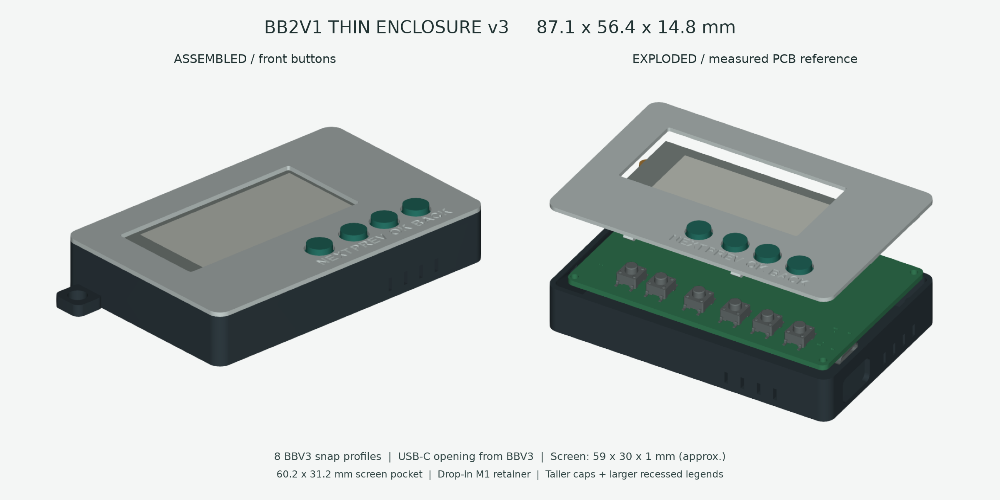
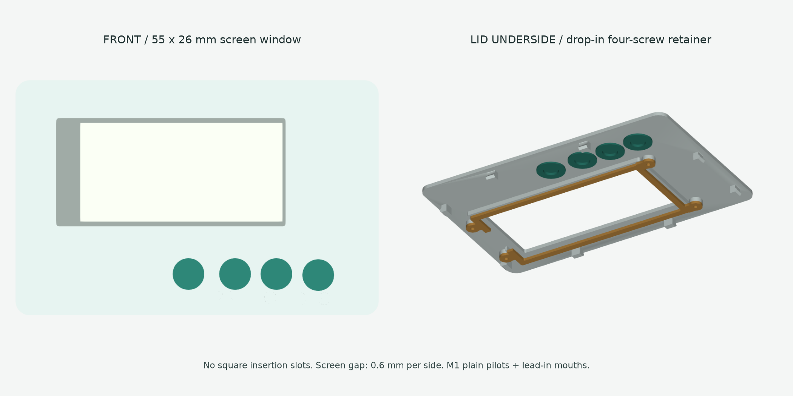

# 墨伴 InkMate

**把一本书、一组单词和一点生活灵感，装进口袋。**

墨伴是一款基于 ESP32 的墨水屏随身挂件，把电子书阅读、单词学习、时钟、日常记录和轻量趣味功能放在一块小屏幕上。它不是一台缩小的手机，而是一件可以挂在包上、放在桌边，也能随手拿起来翻两页的小设备。

四颗实体按键负责日常操作；需要换书、管理词库或更新固件时，再用手机或电脑连接设备热点，通过浏览器完成。墨水屏刷新后可以保持画面，但这不代表整机没有待机耗电，本项目不承诺未经实测的续航时间。

本仓库集中保存**当前最新版固件源码与外壳设计**。软件未添加项目级授权协议，第三方内容仍遵守各自原有许可，详见[使用与授权说明](docs/PERMISSIONS.md)及[第三方说明](THIRD_PARTY_NOTICES.md)。请不要将“源码公开”理解为商业使用授权。



> 上图为 CAD 设计预览，不是成品照片。当前整理版本：固件 **v2.8.0**、外壳 **v3**。下载包中的固件文件名仍沿用 `FortunePager`，Arduino 工程名仍沿用 `CyberFortune_CZ04_2Buttons`，这是为了保留现有烧录和构建流程，并不是不同的产品。

## 可以用它做什么

### 随身读一点

在网页中上传一本 TXT、Markdown 或 DOCX 文档，再回到设备上前后翻页阅读。DOCX 在浏览器侧提取文字，不保留原文复杂排版，也不等同于 Word 阅读器。设备保存阅读位置，适合短篇、摘录、备忘和碎片阅读；不支持 PDF、EPUB 或 DRM 电子书。

v2.8.0 针对较大文件采用分块上传和稀疏分页索引，不需要把整本书一次性装进内存。目前设备保存一份当前电子书，上传新书会替换它，并不是多书书架。

### 每天学几个单词

内置六级高频和雅思核心两套词库，也可以上传自己的 UTF-8 TSV 词库。它们是来自词库项目的精选条目，不是考试机构发布或认证的完整考试词表。

- 每日新词数量可在网页设置为 5～30，默认 10 个。
- 先显示单词，按 OK 查看释义，再根据记忆情况选择“忘记”“模糊”或“认识”。
- 优先处理到期复习，再补充当天的新词；到期较多时可分批继续学习。
- 记录每个词的阶段和下次复习日期，断电后保留进度。
- 使用简单的阶段式间隔复习规则，不宣称采用 FSRS 或完整的 SM-2 算法。

六级词库目前约 2,482 条，雅思词库约 4,974 条。词库来源与许可说明保存在[数据目录](firmware/CyberFortune_CZ04_2Buttons/data/README.md)。替换某个词库会重置该词库的学习进度，另一个词库不受影响。

### 看时间，做一点生活记录

PCF8563 提供日期和时间，网页可以校时。设备还提供番茄钟、待办、喝水记录、心情状态和三餐提醒等轻量功能。待办最多保存 12 项，番茄钟采用 25 分钟专注、5 分钟休息。

日期相关功能依赖正确的 RTC 时间。首次使用或 RTC 时间失效后，应先校时，再开始单词计划和每日记录。

### 不那么严肃的小工具

保留抽签、塔罗、今天吃什么、今天喝什么、D6 / D20 骰子、抛硬币、随机数和 YES / NO 等趣味页面。部分每日结果会保存，也可以手动重抽。它们仅供娱乐，不用于健康、财务或其他重大决策。

还可以从网页上传并处理黑白图片，让它显示喜欢的图案；功能页面可以在网页中按喜好启用或隐藏。

### 用网页管理，不必安装专用 App

- 上传或删除当前电子书，替换词库和图片。
- 设置每日学习量，查看学习进度及设备状态。
- 管理待办、自定义选项和部分日常记录。
- 同时查看实际 Flash 容量、内容分区总量和剩余空间。
- 上传应用固件进行 OTA 更新。

网页运行在设备的局域网热点中，不要求云端账号。默认热点和 OTA 密码仅用于初次上手，不适合不可信环境；不要将设备管理界面暴露到公网。

## 硬件概览

| 项目 | 当前设计 |
| --- | --- |
| 主控 | 经典 ESP32，兼容 4MB / 16MB Flash 配置 |
| 显示 | 当前 CZ04 驱动，绘图区域 212 × 104；不是任意同尺寸屏幕均可替换 |
| 时钟 | PCF8563，I²C 连接 |
| 操作 | 四颗日常功能键，另有 BOOT 与 EN 维护按键 |
| 供电 | 单节锂电池、USB-C 充电相关电路 |
| 反馈 | 振动电机及驱动电路 |
| 外壳 | 3D 打印底壳、卡扣面盖、屏幕压框与四颗独立键帽 |

当前 PCB 参考模型见 [hardware/reference/BB2V1.step](hardware/reference/BB2V1.step)。**STEP 只是机械参考，不是可编辑 PCB 工程，也不能代替原理图、生产 Gerber 或电气检查。** 最新配套原理图、PCB 源工程、BOM 和 Gerber 尚待确认后补充，仓库没有把不同日期的旧制造文件冒充最新版。

### 四键映射

| PCB 位号 | 功能 | ESP32 GPIO |
| --- | --- | --- |
| SW4 | NEXT，下一项 / 下一页 | GPIO32 |
| SW8 | PREV，上一项 / 上一页 | GPIO25 |
| SW5 | OK，确认 | GPIO33 |
| SW2 | BACK，返回 | GPIO26 |

单词评分时，PREV 对应“忘记”，OK 对应“模糊”，NEXT 对应“认识”；未显示释义时先按 OK 显示。SW1 是 EN 复位，SW6 是 GPIO0 / BOOT，面盖没有为这两个维护按键提供日常操作键帽。

主要屏幕与 RTC 引脚见[硬件说明](hardware/README.md)。不要将屏幕接口上的 `RST` 误认为 ESP32 的 `EN` 复位。

## 4MB 与 16MB 的空间

| 项目 | 4MB Flash | 16MB Flash |
| --- | --- | --- |
| 内容分区 | 640 KiB | 12.625 MiB |
| 单次电子书上传上限 | 256 KiB | 8 MiB |
| 单个词库上传上限 | 256 KiB / 5,000 词 | 2 MiB / 20,000 词 |
| 后续网页 OTA | 两种容量使用同一份应用固件 | 两种容量使用同一份应用固件 |

内容空间由电子书、词库、学习记录和图片等共享。表中是配置上限，实际还受剩余空间和保留空间限制。安全替换文件时，原文件和临时文件会同时占用空间；上传失败时保留旧文件。

**16MB 芯片不等于已经获得 16MB 分区布局。** 原来使用 4MB 分区的设备，仅做网页 OTA 不会扩大内容分区。需要先按[烧录说明](firmware/CyberFortune_CZ04_2Buttons/FLASHING_v2.8.0_zh.md)进行一次适配的串口升级，再在网页确认物理容量和内容分区容量。

## 第一次运行

### 1. 获取匹配的固件包

仓库保存源码，编译好的完整烧录包、OTA 文件和打印 ZIP 建议从本仓库的 Releases 下载。发布者尚未建立 Release 时，请等待发布，不要把任意旧 `.bin` 当作当前版本。

完整烧录包包括对应容量的完整镜像、公共 OTA 应用镜像和 `flash_release.py`。首次安装与后续 OTA 是两种不同流程。

### 2. 串口烧录或扩容

CH340 与主板共地，收发交叉：下载器 TX 接 ESP32 RX0，下载器 RX 接 ESP32 TX0。**UART 信号必须为 3.3V 电平**，不要把 5V 信号接到 ESP32 IO，也不要依赖小下载器的 3.3V 引脚承担整板供电。

按住 GPIO0 / BOOT，复位 EN 后再松开 BOOT，进入下载模式。关闭占用串口的监视器。在解压后的完整固件包中运行：

```powershell
python .\flash_release.py --port COM5
```

把 COM5 换成实际端口。脚本会先备份整个 Flash，识别 4MB / 16MB 容量，并检查受支持的旧分区布局。默认迁移只适用于对应 FortunePager 布局，不能用于任意第三方固件。

新板安装或主动清空设备内容时，才使用：

```powershell
python .\flash_release.py --port COM5 --fresh
```

`--fresh` 会替换设置、电子书和学习记录。保管好备份，**不要将个人 Flash 备份上传到 GitHub**。烧录完成后松开 BOOT，复位或重新上电。

### 3. 连接管理网页

进入设备 Wi-Fi 页面并启用热点，连接以下默认网络：

| 项目 | 默认值 |
| --- | --- |
| 热点名 | `FortunePager` |
| 热点密码 | `12345678` |
| 管理地址 | `http://192.168.4.1/` |
| OTA 页面 | `http://192.168.4.1/update` |
| OTA 用户名 / 密码 | `admin` / `12345678` |

这是设备热点的本地地址，手机应保持连接该热点。先校时，再上传内容和设置每日学习计划。热点名称暂未随项目展示名称改动。

### 4. 后续更新

在 OTA 页面上传 `FortunePager_v2.8.0_ota.bin` 这类**应用镜像**。不要上传 `*_full.bin`、分区表或 LittleFS 镜像。普通 OTA 不会安装词库、重建分区或完成 16MB 扩容。

## 从源码构建

主工程位于 [firmware/CyberFortune_CZ04_2Buttons](firmware/CyberFortune_CZ04_2Buttons/)。Arduino 要求主 `.ino` 与所在文件夹同名，所以请保留现有工程名。

已验证的构建使用 Arduino ESP32 Core **3.3.10**，目标为经典 `ESP32 Dev Module`。主要外部库包括 Adafruit GFX、U8g2 for Adafruit GFX 及其依赖；WiFi、WebServer、LittleFS、Preferences 和 ESP32 QR Code 接口由相关 ESP32 软件包提供。

默认 `partitions.csv` 是安全的 4MB 配置，另有 `partitions_16mb.csv`。不要将 16MB 分区或完整镜像用于 4MB 芯片。项目应用槽约 1.625 MiB，IDE 默认约 1.25 MiB 的应用分区会导致“Sketch too big”，这不表示 RAM 耗尽。

Windows 上安装 Arduino IDE、对应 ESP32 Core、必要库和 Python 后，可在工程目录运行：

```powershell
python .\tools\build_release.py
```

构建脚本生成两种容量的完整烧录包和共同的 OTA 应用文件。它沿用现有 Windows / Arduino IDE 工具发现方式，并会向本机 Downloads 复制发布包；其他平台需要调整工具路径。本次仓库整理没有重新编译或更改运行中的功能代码。

## 轻薄 3D 打印外壳

外壳使用与当前 PCB 匹配的轻薄结构，不沿用早期较厚的 BBV3 整体高度，只参考其卡扣结构。屏幕和四颗日常按键同处正面，电池位于背面，USB-C、拨动开关、通风孔、PCB 安装位和侧面挂扣均有对应空间。



当前 v3 的主要尺寸与修正：

- 主体约 **87.1 × 56.4 × 14.8 mm**，不含侧面挂扣；含突出的键帽，最大厚度约 **16.2 mm**。
- 按约 59 × 30 × 1 mm 屏幕设计，屏幕容纳槽为 **60.2 × 31.2 mm**，可视开窗为 **55 × 26 mm**。
- 屏幕压框取消原先依赖精细方槽的插入夹持结构，改为从内侧直接放入，用四颗 **M1 螺丝**固定。
- 螺丝直接拧入塑料导孔，**没有建模螺纹，不需要螺母**；建议 M1 × 2 mm，未经复核不要超过 2.5 mm。
- 键帽下部裙边缩短，顶部加高并放宽活动间隙；正常就位后约突出面盖 1.2～1.4 mm。
- 面板凹刻 NEXT / PREV / OK / BACK，字号 4 mm、凹深 0.6 mm。
- 挂扣位于侧面，孔径 5 mm。底壳与 v2 几何保持一致，已有 v2 底壳可继续使用。

打印时使用 [enclosure/v3/print](enclosure/v3/print/) 下的七个 STL，单位毫米、比例 100%。这七个文件是底壳、面盖、压框和四颗键帽。STEP 用于编辑，不必把 STEP 再导入切片软件重新定向。

装配顺序、M1 导孔和屏幕保护说明见[外壳装配指南](enclosure/v3/README.md)。屏幕边缘需柔性绝缘缓冲，压框不得压迫有效显示区或排线焊接区。锂电池不能靠合盖挤压固定。

**v3 已做数字几何检查，但尚未确认新一轮实物打印装配。** 实际打印缩孔、材料和螺丝牙型会影响配合，不应强行拧紧或强扣面盖。

## 仓库结构

```text
InkMate/
├─ README.md                 项目首页
├─ THIRD_PARTY_NOTICES.md     第三方来源与待确认事项
├─ firmware/                 v2.8.0 源码、词库与工具
├─ hardware/                 PCB 机械参考及硬件说明
├─ enclosure/v3/             最新打印件、STEP、生成源代码
├─ docs/                     使用说明、版本摘要、图片与验证记录
└─ licenses/                 非软件设计许可原文
```

旧固件、旧说明和旧外壳发布包存放在仓库外的归档目录，不混入最新版源码。编译输出、Python 环境、个人 Flash 备份和生成的 ZIP 均不应提交。

## 已验证与仍需确认

- 固件 v2.8.0 曾完成编译、存储逻辑及网页自动化检查；已有电子书上传、词库和较大分页场景的数字测试。
- 外壳包含 CAD 配合与 STL 网格检查记录，可在 [docs/validation](docs/validation/) 查看；它们不能替代实际试装。
- 本次整理未进行实际 4MB / 16MB 设备烧录和续航测量，没有宣称全硬件验证完成。
- 当前 PCB STEP 不包含实际屏幕实体；屏幕尺寸来自近似测量。不同批次屏幕、开关和 USB-C 器件可能需要重新核对。
- 原理图、可编辑 PCB 与生产资料的最终一致版本尚待补齐；不要仅据参考模型下单生产。
- 历史墨水屏驱动、图标及字库来源尚需补全授权审计，不能仅凭本仓库的说明认定所有内容均可再授权。

## 使用与授权

项目原创软件目前**未提供项目级使用或分发许可**，未选择 MIT、Apache、GPL 或其他软件许可。公开仓库不等于许可商业使用；第三方依赖、词库以及已有许可文件仍分别适用原有条款。

本项目有权授权的原创外壳设计和原创说明文档采用 **CC BY-NC-SA 4.0**：署名、非商业使用、以相同方式共享。它不是软件许可，也不替代第三方 CAD 模型、历史代码或词库的许可。需要商业使用时应先取得相关权利人的书面授权。

完整范围说明见 [docs/PERMISSIONS.md](docs/PERMISSIONS.md)，来源见 [THIRD_PARTY_NOTICES.md](THIRD_PARTY_NOTICES.md)。授权条款不提供安全、适配或续航保证；复刻前请自行核对电气、充电、绝缘和机械风险。
