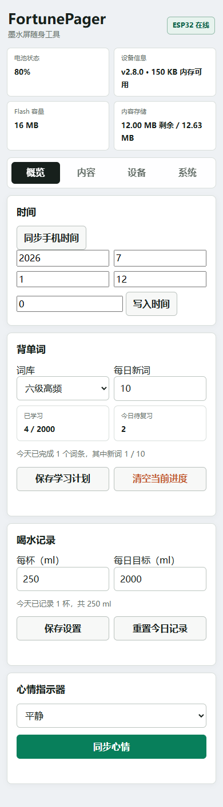

# 网页使用指南

InkMate 的网页管理界面运行在设备上，用手机或电脑的浏览器访问即可。这里的网页标题和热点名沿用 FortunePager。

## 一、连接设备

1. 给 InkMate 上电，设备会自动启动 Wi-Fi 热点。
2. 在手机或电脑的 Wi-Fi 设置中连接 `FortunePager`，密码是 `12345678`。
3. 手机提示该网络没有互联网时，选择“保持连接”或“仍然使用”。
4. 打开浏览器，在地址栏输入 **`http://192.168.4.1/`**。

本体的 Wi-Fi 二维码页也会显示热点名、密码和管理地址。二维码用于连接 Wi-Fi，连接后再打开管理地址。

第一次使用建议按这个顺序：**同步时间 → 设置学习计划 → 上传电子书或图片 → 选择本体功能菜单**。

## 二、先认识网页布局

网页上方是设备信息，下方有四个标签页。

| 标签 | 里面有什么 |
| --- | --- |
| 概览 | 时间、背单词、喝水记录、心情指示器 |
| 内容 | 食物候选、饮品候选、待办事项、电子书、词库文件、图片上传 |
| 设备 | 24 项本体功能的显示开关 |
| 系统 | OTA 固件更新入口、16MB 旧分区扩容提示 |

上方信息的含义：

- **电池状态**：电量、电压和充电状态，`charging` 为充电中，`full` 为充电完成。
- **设备信息**：当前固件版本和可用内存。
- **Flash 容量**：实际芯片容量，显示 4MB 或 16MB。
- **内容存储**：文件区剩余空间和总空间，电子书、词库、图片及记录共享这部分空间。



## 三、概览

### 同步或手动设置时间

直接点击 **同步手机时间**，会把浏览器所在手机或电脑的当前时间写入 PCF8563。

也可以填写年、月、日、时、分，点击 **写入时间**。先完成校时，再使用每日单词计划、每日结果、喝水记录和三餐提醒。

### 设置单词学习计划

1. 在 **背单词** 中选择“六级高频”或“雅思核心”。
2. 填写 **每日新词**，范围 5～30，默认 10。
3. 点击 **保存学习计划**。
4. 回到本体，找到“背单词”，按 OK 开始。

页面会显示：

- 已学习词数 / 当前词库总词数。
- 今日到期的待复习词数。
- 今天完成的词条数，其中的新词完成数及目标。

“每日新词”只控制新增单词，到期复习另外安排，因此当天总学习量可以大于新词目标。完成一批后，本体可再次按 OK 继续剩余的到期复习。

切换词库时会自动保存选择，两套词库分别保存学习进度。点击 **清空当前进度** 并确认，会重置当前所选词库的记录。

在本体学习后，刷新网页即可重新读取统计。

### 设置喝水记录

1. 填写 **每杯（ml）**，范围 100～1000。
2. 填写 **每日目标（ml）**，范围 500～5000。
3. 点击 **保存设置**。
4. 在本体“喝水记录”页面，每按一次 OK，就记录一杯。

默认每杯 250 ml，每日目标 2000 ml。网页显示当天杯数及总饮水量；点击 **重置今日记录** 可以清零当天杯数。设备按 RTC 日期换日清零。

### 同步心情

在下拉框选择开心、平静、一般、疲惫、焦虑、愤怒或难过，点击 **同步心情**。本体“心情指示器”显示对应文字和表情，在本体按 OK 也能依次切换。

## 四、内容

### 自定义“今天吃什么”

1. 在 **今天吃什么候选** 勾选希望参加抽取的内置食物。
2. 在“添加食物”输入框填写自己的选项，点击 **添加**。
3. 可直接编辑自定义选项，或点击旁边的 **删** 移除。
4. 点击 **保存食物候选**。

自定义食物最多 12 项，每项输入最多 20 个字符。至少保留一个内置或自定义候选。保存后，本体会根据新的候选重新推荐，在食物页面按 OK 还能再选一次。

### 自定义“今天喝什么”

与食物相同：选择内置饮品、添加自定义内容，最后点击 **保存饮品候选**。自定义饮品也最多 12 项。

### 编辑待办事项

1. 在 **待办事项** 点击 **新增待办**。
2. 输入事项内容；勾选左侧复选框表示已完成，右侧 **删除** 移除该项。
3. 点击 **同步到设备** 保存整份列表。

最多保存 12 项，每个输入框最多 40 个字符。新增、编辑、勾选和删除后，都需点击“同步到设备”。

本体显示完成数量和列表前 3 条内容，按 OK 会按顺序完成下一条未完成事项。刷新网页可以读取本体更新后的状态。

### 上传电子书

1. 在 **电子书** 中选择 `.txt`、`.md` 或 `.docx` 文件。
2. 查看下面显示的 **本次上限**。
3. 点击 **上传电子书**，等待出现“上传完成”。
4. 在本体找到“电子书”，按 OK 从第 1 页开始阅读。
5. 阅读中用 NEXT / PREV 翻页，按 OK 或 BACK 退出。

TXT / Markdown 使用 UTF-8 文本。DOCX 由浏览器提取正文后上传，屏幕以文字排版显示。文件名会用作书名，设备保存一份当前电子书，上传新书替换原书。

点击 **删除电子书** 并确认，可移除当前书籍并释放空间。

### 上传自己的词库

1. 准备一个 **UTF-8 编码的 TSV** 文件，也可以使用符合相同格式的 `.txt`。
2. 每行一条，格式为 **单词 + 一个 TAB 制表符 + 释义**，不加表头或空行。
3. 在 **词库文件 → 替换词库** 选择六级或雅思。
4. 选择文件，点击 **上传词库**，确认替换。
5. 回到“概览”，选择对应词库和每日新词数量；然后在本体开始学习。

示例（中间使用真实的 TAB）：

```tsv
abandon	v. 放弃；抛弃
achieve	v. 达到；实现
benefit	n. 益处；v. 使受益
```

每行最多 256 字节，包含英文、制表符和中文释义。用电子表格准备两列后导出为 UTF-8 TSV 也可以。

**替换词库会清空该库的学习进度，另一词库的进度保留。** 网页中的“六级 / 雅思”是两个固定存储位置，自定义词库替换其中一个位置。

### 上传图片

1. 在 **图片上传** 选择图片。
2. 在裁切区拖动图片，调整主体位置。
3. 拖动 **缩放** 滑杆，范围 100%～400%；点击 **旋转 90°** 可以调整方向。
4. 点击 **重新适配** 可将图片重新适配到画面。
5. 选择黑白处理方式：

| 模式 | 适合内容 | 调整方法 |
| --- | --- | --- |
| 清晰二值 | 文字、图标、线稿 | 调整阈值，控制明暗分界 |
| 照片抖动 | 人像、风景等照片 | 用黑白点阵表现层次，结合预览调整 |

6. 需要时勾选 **黑白反色**。
7. 查看下方 **212 × 104** 墨水屏预览，满意后点击 **发送到墨水屏**。

发送后保存为当前图片，本体“我的图片”页面可以再次显示，断电后文件仍保留。

## 五、设备：定制本体菜单

1. 点击 **设备** 标签。
2. 勾选想保留的应用功能，取消勾选暂时不用的功能。
3. 点击 **保存设备菜单**。

也可以先按 **全部启用** 或 **全部隐藏**，再单独选择。保存后，本体用 NEXT / PREV 切页时会跳过隐藏功能，首页和 Wi-Fi 二维码页保留。

隐藏功能不会删除对应电子书、词库、图片或学习记录。三餐提醒关闭后，停止其自动提醒。

## 六、系统：更新固件

1. 准备发布包中的 **`FortunePager_v2.8.0_ota.bin`** 应用文件。
2. 点击 **系统 → 打开 OTA 更新**。
3. 浏览器提示登录时，用户名填写 `admin`，密码填写 `12345678`。
4. 在更新页选择 OTA 应用 `.bin` 文件，并提交上传。
5. 等待“更新成功，设备正在重启”，重新连接热点并打开管理网页。
6. 查看顶部固件版本。

4MB 和 16MB 使用同一份 OTA 应用文件。OTA 页面只接收应用镜像，完整烧录镜像 `*_full.bin` 用于串口烧录。

旧 4MB 分区布局的 16MB 设备，会在“系统”显示扩容提示。按[串口扩容步骤](../firmware/CyberFortune_CZ04_2Buttons/FLASHING_v2.8.0_zh.md)迁移一次分区后，内容空间增加至约 12.6 MiB，之后继续使用网页 OTA。

## 七、容量怎么判断

| 配置 | 内容总空间 | 单本电子书上限 | 单个词库上限 |
| --- | --- | --- | --- |
| 4MB | 640 KiB | 256 KiB | 256 KiB / 5,000 词 |
| 16MB 扩容配置 | 12.625 MiB | 8 MiB | 2 MiB / 20,000 词 |

电子书、两套词库、学习记录和图片共享内容空间。网页会根据实际剩余空间给出“本次上限”。替换时先写临时文件，成功后替换旧文件，所以需要同时容纳新旧文件。

新书超过“本次上限”时，可先点击“删除电子书”释放旧书空间，再上传新书。DOCX 的上传容量按提取后的 UTF-8 文字大小计算。

## 八、常用操作速查

| 想做的事 | 在哪里操作 |
| --- | --- |
| 校时 | 概览 → 时间 → 同步手机时间 |
| 设置每天学几个新词 | 概览 → 背单词 → 每日新词 → 保存学习计划 |
| 切换六级 / 雅思 | 概览 → 背单词 → 词库 |
| 重置某套学习记录 | 概览 → 背单词 → 清空当前进度 |
| 换书 | 内容 → 电子书 → 上传电子书 |
| 换词库 | 内容 → 词库文件 → 上传词库 |
| 换屏幕图片 | 内容 → 图片上传 → 发送到墨水屏 |
| 改食物 / 饮品候选 | 内容 → 对应候选 → 保存 |
| 改待办 | 内容 → 待办事项 → 同步到设备 |
| 隐藏本体功能 | 设备 → 勾选功能 → 保存设备菜单 |
| 看 4MB / 16MB 和剩余空间 | 网页顶端 Flash 容量、内容存储 |
| 更新固件 | 系统 → 打开 OTA 更新 |

## 九、遇到提示时怎么处理

| 现象 | 操作 |
| --- | --- |
| 连接热点后手机显示“无互联网” | 保持连接，浏览器打开 `http://192.168.4.1/` |
| 网页打不开 | 检查是否仍连接 FortunePager；地址使用 `http`，并直接输入地址栏 |
| 本体找不到某项功能 | 网页“设备”勾选该功能并保存 |
| 电子书中文乱码 | 将文本另存为 UTF-8 后重新上传 |
| DOCX 提示浏览器不能解压 | 在电脑上另存为 UTF-8 TXT 后上传 |
| 提示词库格式错误 | 检查真实 TAB、每行一词、无空行，编码为 UTF-8 |
| 上传提示空间不足 | 看本次上限，删除旧书或缩小文件后重试 |
| 16MB 但内容区只有约 640 KiB | 完成一次对应的串口分区扩容 |
| 页面统计与本体刚完成的操作不同 | 刷新网页重新读取 |
| OTA 更新失败 | 检查是否选择 OTA 应用文件，保持稳定供电；115200 串口查看更新日志 |

返回[项目首页](../README.md)，或查看[本体操作指南](DEVICE_GUIDE.md)。
